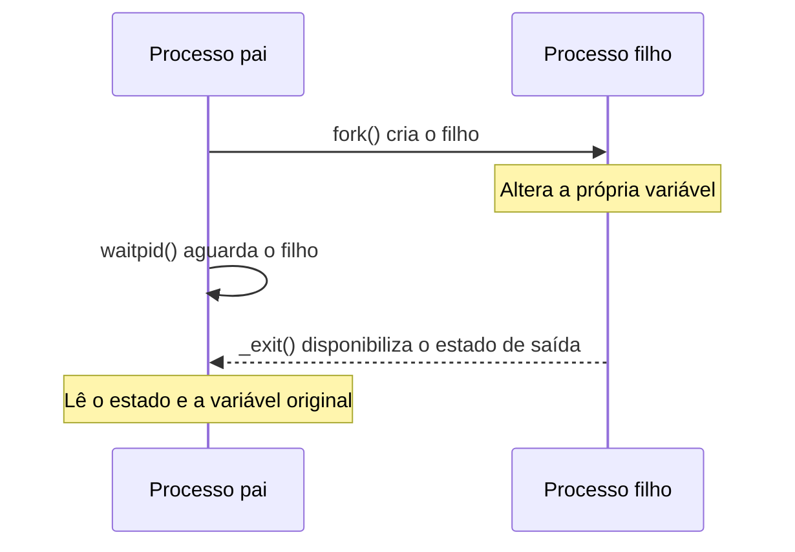

# Roteiro de exercícios

Compile com `make -j` antes de começar. Rode `make test` a cada mudança para verificar o comportamento original.

## 1. Inspecione a cópia de um arquivo

Crie um arquivo de teste, execute a cópia e veja as chamadas que abrem os arquivos e transferem os dados.

```sh
pasta=$(mktemp -d)
printf 'ABC\n' > "$pasta/origem.txt"
strace -e trace=open,openat,read,write,close ./build/syscalls/copy_file \
  "$pasta/origem.txt" "$pasta/copia.txt"
cmp "$pasta/origem.txt" "$pasta/copia.txt"
```

Execute a cópia de novo com o mesmo destino. O programa deve terminar com status diferente de zero e o conteúdo do arquivo de destino deve permanecer intacto. Use `echo "$?"` logo após rodar a cópia para ver o código de saída.

Crie também um arquivo vazio e copie para um novo destino. Compare as execuções e procure onde `read()` retorna zero.

```sh
: > "$pasta/vazio.txt"
strace -e trace=read,write ./build/syscalls/copy_file "$pasta/vazio.txt" "$pasta/copia-vazia.txt"
```

## 2. Leia posições em um descritor

Com o arquivo do exercício anterior, leia o primeiro e o último byte. Depois, tente ler na posição imediatamente seguinte.

```sh
./build/syscalls/file_seek "$pasta/origem.txt" 0
./build/syscalls/file_seek "$pasta/origem.txt" 3
./build/syscalls/file_seek "$pasta/origem.txt" 4
```

As duas primeiras leituras devem mostrar `0x41` e `0x0A`. A terceira deve indicar fim de arquivo. Ao terminar, remova a pasta temporária com `rm -r -- "$pasta"`.

## 3. Observe a saída de um processo filho

Rode `fork_wait` e localize no código onde cada processo lê a variável e onde o pai espera o filho. Depois, altere o valor passado a `_exit()` e confira se o pai reporta o novo código.

A sequência abaixo mostra as responsabilidades de cada processo.



Em `fork_exec`, troque o primeiro argumento de `execlp()` por um caminho inexistente. Confira o diagnóstico emitido pelo filho e o código que o processo pai devolve ao shell.

## 4. Transfira uma mensagem entre processos

Rode `pipe_ipc` e anote qual processo fecha cada ponta e em que momento. Troque a mensagem por um texto com mais de 16 bytes. Como o buffer de leitura tem oito bytes, serão necessárias pelo menos três leituras com dados para reconstruir a mensagem. Confirme que o pai imprime o texto inteiro.

Use `timeout 5s ./build/processos/pipe_ipc` ao experimentar mudanças no fechamento das pontas. O leitor só recebe fim de arquivo quando todas as pontas de escrita daquele pipe estiverem fechadas.

## 5. Mude o trabalho das threads

Altere os valores de entrada de `pthread_join` e confira os resultados. Cada thread escreve em sua própria estrutura de argumentos e a thread principal só lê o resultado após `pthread_join()`.

Em `mutex_counter`, dobre a quantidade de incrementos por thread. O resultado esperado deve dobrar. Rode o programa algumas vezes e confira se o total se mantém. Em seguida, use o código da fila para identificar separadamente o estado compartilhado, o mutex que o protege e os predicados que cada thread espera.

Em `condvar_queue`, mude `ITEM_COUNT` e calcule a soma esperada antes de executar. O consumidor deve receber todos os itens em ordem e terminar após o produtor fechar a fila.
